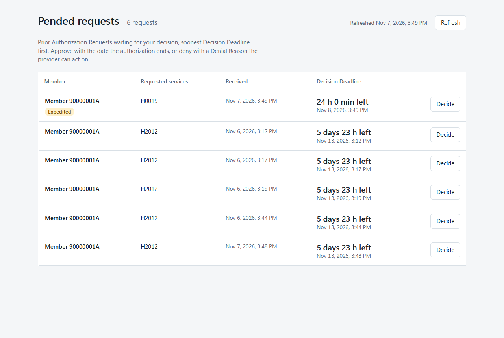
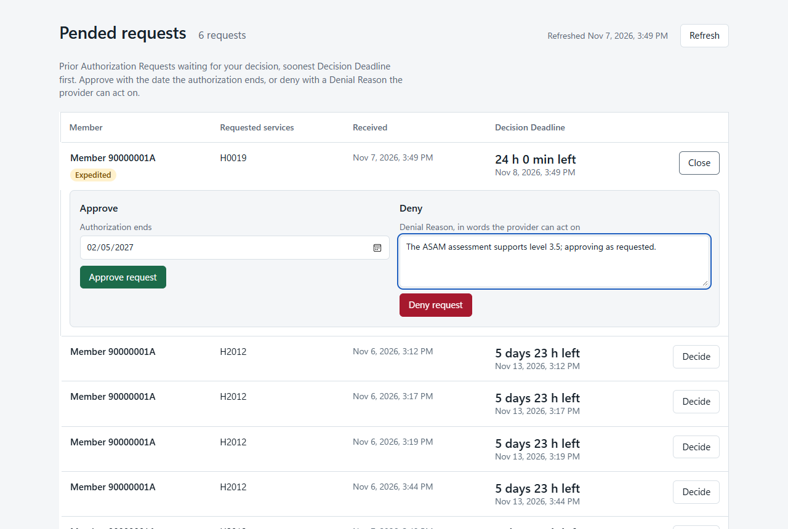
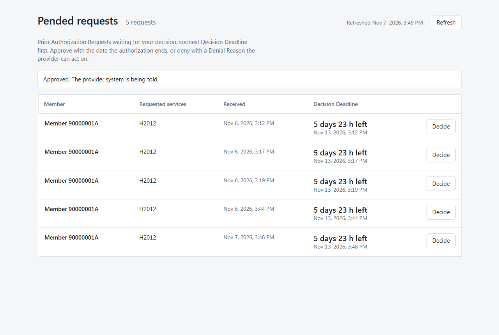

# CMS-0057-F Prior Authorization — proof of concept

Payer-side Prior Authorization APIs for a county Behavioral Health Plan. C# / .NET 10. Mirrors Da Vinci's
`br-payer` reference implementation so its companion `br-provider` can talk to it.

**Proof of concept. Synthetic data only. Not a product of any agency, not a statement of policy.**

Reading guide: this file = run it + what each API does. Deep notes (profile validation, PDex field mapping,
br-provider setup) in [docs/notes.md](docs/notes.md). Vocabulary in [GLOSSARY.md](GLOSSARY.md). Guide versions
and why in [docs/adr/0001](docs/adr/0001-target-current-da-vinci-guide-versions.md).

## What it does

- Provider system submits a Prior Authorization Request (Da Vinci PAS Bundle). Answer at once:
  **Not Required** (`A3`) or **Pended** (`A4`) with a Decision Deadline.
- Reviewer approves (`A1`, Authorization Number + end date) or denies (`A2`, plain-language Denial Reason, coded
  reason optional). Provider inquires, or subscribes and gets told.
- EHR asks at order sign if prior auth is needed (CRD). Its DTR app fetches the Documentation Questionnaire, full
  or adaptive (DTR).
- Patient Access API reads each Member's prior authorization info (PDex ExplanationOfBenefit).
- Provider Access API: provider gets its attributed Members' info. Opt-Out honoured.
- Payer-to-Payer API: another payer matches a Member who opted in, gets their info. Rule's filter applied.
- Public metrics report. Request validation against PAS profiles.

Deadlines (configurable, `appsettings.json` → `Requirements`):

| Service | Standard | Expedited | Source |
| --- | --- | --- | --- |
| Residential SUD treatment (`H0019` + `U1`/`U2`/`U3`) | 24 h | 24 h | DHCS BHIN 24-001 |
| Specialty mental health (`H2012`, `H2019`, `H0040`, `S5145`) | 5 business days, max 7 calendar | 72 h | DHCS BHIN 26-030, 42 CFR 438.210(d) |

## Run it

Needs: .NET 10 SDK; SQL Server 2019+ at `localhost`, Windows auth (change `ConnectionStrings:PriorAuthorization`
otherwise). DB created + migrated on first start. Development seeds 3 Members: `90000001A`, `90000002B`, `90000003C`.

```bash
dotnet run --project src/Cms0057.PriorAuthorization
```

Listens on `http://localhost:5198`.

```bash
dotnet test
```

Tests run the service over HTTP, each on a throwaway DB (`CMS0057_TEST_SQLSERVER` for another instance), fake
clock. No running service needed. Read them as the spec: [tests/](tests/Cms0057.PriorAuthorization.Tests).

## Ten-minute tour

1. Start the service (above).
2. Submit a request as a provider system. Easiest: the br-provider replay (needs bash, curl, Python 3, Windows
   PowerShell). Gets a token, submits an `H2012` request → Pended.

   ```bash
   bash samples/br-provider/replay.sh
   ```

   Step by step instead: open [`PriorAuthorization.http`](src/Cms0057.PriorAuthorization/PriorAuthorization.http)
   (VS / VS Code REST Client). Run `./samples/New-ClientAssertion.ps1`, paste output into `@clientAssertion`, send
   step A (token), then step 1 (residential request `H0019 U1`). Steps 0, 0b, 0c = CRD and DTR first.
3. Open [http://localhost:5198/reviewer](http://localhost:5198/reviewer). Pended requests, soonest deadline first,
   Overdue marked. No sign-in (none anywhere in the PoC).

   

4. Click **Decide**. Approve with end date, or deny with a Denial Reason.

   

   Approve → request leaves the list, provider's Subscription notified, ClaimResponse now carries Authorization
   Number + period (`.http` step 4 to see it).

   

5. Public metrics (rule: post yearly by March 31 for prior year):

   ```bash
   curl "http://localhost:5198/reports/prior-authorization-metrics?year=2026"
   ```

   ```json
   {"year":2026,"servicesRequiringPriorAuthorization":["H0019 U1","H0019 U2","H0019 U3","H0040","H2012","H2019","S5145"],
    "requestsReceived":8,"approved":3,"denied":0,"cancelled":0,"undecided":5,"approvedPercent":37.5,"deniedPercent":0,
    "averageHoursToDecision":0,"medianHoursToDecision":0}
   ```

6. Rest of the `.http` file: inquiry + update (4, 6), Patient Access (7), Provider Access + `$export` (8),
   Payer-to-Payer `$member-match` + `$everything` (9). Each step states the expected answer.

Full br-provider UI end to end (Java, Maven, Node): [docs/notes.md](docs/notes.md#running-da-vincis-br-provider-against-it).

## Endpoints

| Endpoint | Guide | Purpose |
| --- | --- | --- |
| `GET /.well-known/smart-configuration`, `POST /auth/token` | SMART Backend Services | Token discovery + issue |
| `POST /fhir/Claim/$submit` | PAS 2.2.1 | Submit request → PAS response Bundle |
| `POST /fhir/Claim/$inquire` | PAS 2.2.1 | Provider asks about its requests for a Member |
| `GET /fhir/ClaimResponse/{id}` | PAS 2.2.1 | One response by id (notification target) |
| `POST /fhir/Subscription`, `GET /fhir/Subscription?url=&status=` | PAS / Subscriptions Backport | Decision notifications; look up existing |
| `GET /cds-services`, `POST /cds-services/order-sign-crd` | CRD 2.2.1 | Prior auth needed? Which questionnaire? |
| `POST /fhir/Questionnaire/$questionnaire-package` | DTR 2.2.0 | Questionnaire(s) + started QuestionnaireResponse |
| `POST /fhir/Questionnaire/$next-question` | DTR 2.2.0 / SDC | Next questions of an adaptive form |
| `GET /fhir/ExplanationOfBenefit?patient=&_lastUpdated=`, `GET /fhir/ExplanationOfBenefit/{id}` | PDex 2.1.0 | Member's prior auth info, one EOB per request |
| `GET /fhir/Group`, `GET /fhir/Group/{id}` | PDex 2.1.0 / ATR 2.1.0 | Caller's own Attribution List or Member Match Group |
| `GET`/`POST /fhir/Group/{id}/$export`, `GET /fhir/$export-status/{job}`, `GET /fhir/$export-files/{job}/{type}.ndjson` | Bulk Data 1.0 | Export the Group's prior auth info |
| `POST /fhir/Patient/$member-match` | HRex 1.1.0 | Other payer finds an opted-in Member |
| `GET /fhir/Patient/{id}/$everything` | PDex 2.1.0 | All shared about a matched Member |
| `PUT /members/{id}/provider-access` | — | Staff: Opt-Out `{"optedOut": true\|false}` |
| `POST /members/{id}/attributions` | — | Staff: attribute Member to provider NPI |
| `PUT /members/{id}/payer-to-payer` | — | Staff: Opt-In `{"optedIn": true\|false}` |
| `GET /reviewer`, `GET /reviewer/pended-requests`, `GET /reviewer/denial-reason-codes` | — | Reviewer page + its data |
| `POST /reviewer/requests/{id}/approve`, `.../deny` | — | Reviewer decision |
| `GET /reports/prior-authorization-metrics?year=` | — | Public metrics |

`/fhir/*` and `/cds-services/*` need a token. `/reviewer/*`, `/members/*`, `/reports/*` have none (staff auth =
open issue).

## Authentication

SMART App Launch 1.0 Backend Services. Systems authenticate with a key pair, not a password. On by default;
`Authentication:Enabled: false` for a token-less local demo.

1. **Register**: client id, scopes, public JWK Set (inline or URL) under `Authentication:Clients`. Sample clients
   ship, all signing with one published **synthetic** key: [`samples/sample-provider-system.private.jwk.json`](samples/sample-provider-system.private.jwk.json).
2. **Discover**: `GET /.well-known/smart-configuration` → token endpoint, `private_key_jwt`, `RS384`/`ES384`, scopes.
3. **Assert**: sign JWT, `iss`=`sub`=client id, `aud`=token endpoint, `exp` ≤ 5 min, unique `jti` (replay refused).
   [`samples/New-ClientAssertion.ps1`](samples/New-ClientAssertion.ps1) does it.
4. **Token**: `POST /auth/token`, `grant_type=client_credentials` + assertion + `scope`. Bearer token, 5 min.
   Missing/expired → 401. Wrong scope → 403.

Who sees what = client `Kind`, not scopes:

| Kind | Sample client | Sees |
| --- | --- | --- |
| `ProviderSystem` (default) + `OrganizationIdentifier` = NPI | `sample-provider-system`, `br-provider` | Own requests; attributed Members (Provider Access) |
| `PatientAccessApi` | `sample-patient-access-api` | Every Member's prior auth info |
| `Payer` + `OrganizationIdentifier` | `sample-other-payer` | Matched, opted-in Members (Payer-to-Payer) |

Scopes: `system/Claim.write` submit · `system/Claim.read` inquire · `system/ClaimResponse.read` ·
`system/Subscription.write|read` · `system/Questionnaire.read` DTR · `system/ExplanationOfBenefit.read` ·
`system/Group.read` · `system/Patient.read` match + `$everything`. SMART v2 spelling (`system/Claim.crus`)
accepted. Partial grants allowed; token says what was granted.

## Patient Access API (42 CFR 422.119(b)(1)(iv); Medicaid 438.242(b)(5))

Rule, from 2027-01-01: show Member status, decision date, end date, services approved, denial reason, related
documentation. Within 1 business day of change. Keep while active + 1 year.

Built = payer side the agency's existing Patient Access API reads from (vendor assumed, see issues). Not the
Member-facing app.

- `GET /fhir/ExplanationOfBenefit?patient={id}`: all requests for the Member, oldest first, each a
  [PDex Prior Authorization EOB](https://hl7.org/fhir/us/davinci-pdex/STU2.1/StructureDefinition-pdex-priorauthorization.html).
  `_lastUpdated=ge…` = only changed since.
- Same decision the provider sees: review action `A1`–`A4` on `adjudication`, decision date, Authorization Number,
  denial reason (X12 886 code + Reviewer's words), authorization period, items with HCPCS + modifiers.
- Nothing deleted → retention met.
- Validates with 0 errors against PDex 2.1. Field mapping + caveats: [docs/notes.md](docs/notes.md#pdex-explanationofbenefit-mapping).
- Not in it: provider's documentation (none received yet), units used, referenced Patient/Coverage/Organization.

## Provider Access API (42 CFR 422.121(a); Medicaid 438.242(b)(7))

Rule, from 2027-01-01: in-network provider gets attributed Members' data within 1 business day unless Member opted out.

- **Attribution**: automatic when provider submits a request for the Member (by provider NPI); or staff
  `POST /members/{id}/attributions`.
- **Opt-Out**: `PUT /members/{id}/provider-access`. Removes Member from every list, blocks every provider read.
  Reversible.
- **List**: `GET /fhir/Group` → caller's own [PDex Provider Group](https://hl7.org/fhir/us/davinci-pdex/STU2.1/StructureDefinition-pdex-provider-group.html)
  (`provider-{NPI}`). Others' lists → 404.
- **Export**: `Group/{id}/$export` (`Prefer: respond-async`) → 202 + `Content-Location` → manifest → ndjson of EOBs.
  `_since`, `_type=ExplanationOfBenefit`, ndjson only. Complete immediately (small data). Jobs in memory; owner only.
- **One Member**: `GET /fhir/ExplanationOfBenefit?patient=` if attributed, else 403.
- Not built: PDex `Consent` for opt-out, `$davinci-data-export`, claims/encounter/clinical data (not held here).

## Payer-to-Payer API (42 CFR 422.121(b); Medicaid 438.242(b)(7))

Rule, from 2027-01-01: Member opts in → old plan shares data (5 years, no denied PAs, no remittances/cost-sharing)
within 1 week of new payer's request.

- **Opt-In**: `PUT /members/{id}/payer-to-payer`. Nothing shared until true. False = stop at once.
- **Match**: payer (`Kind: Payer`) sends `POST /fhir/Patient/$member-match`
  ([HRex](https://hl7.org/fhir/us/davinci-hrex/STU1.1/OperationDefinition-member-match.html) Parameters:
  `MemberPatient`, `CoverageToMatch`, `Consent`). Exactly one Member by identifier + name, opted in, Consent period
  not ended → `MemberIdentifier` (UMB) + `MemberId`. Else 422 OperationOutcome. Malformed → 400.
- **Group**: `GET /fhir/Group` → caller's [PDex Member Match Group](https://hl7.org/fhir/us/davinci-pdex/STU2.1/StructureDefinition-pdex-member-match-group.html)
  (`payer-{id}`), only Members still opted in + Consent in period.
- **Fetch**: `$export` as above, `ExplanationOfBenefit?patient=`, or `GET /fhir/Patient/{id}/$everything`.
- **Filter on everything shared**: no denied; received within 5 years; active (Pended, or Approved not yet ended)
  or status changed within 1 year. Filtered-out request read by id → 403.
- Validates 0 errors: Group vs PDex 2.1.0, match in/out vs HRex 1.1.0.
- Not built: `$bulk-member-match`, this plan as *requesting* payer, QuestionnaireResponse documentation,
  claims/encounter/clinical data.

## Configuration

[`appsettings.json`](src/Cms0057.PriorAuthorization/appsettings.json):

- `ConnectionStrings:PriorAuthorization`
- `Authentication`: `Enabled`, `RequireTokenForCdsHooks`, `Clients[]` (id, scopes, JWKS, `Kind`, `OrganizationIdentifier`)
- `Requirements[]`: services (code + modifiers), standard/expedited decision times, questionnaire canonical
- `DenialReasonCodes[]`: plan's licensed X12 886 codes
- `ValidateProfiles` (default on), `FhirPackageServer`, `FhirPackageFolder` (packages fetched once, ~40 MB, git-ignored)
- `QuestionnaireFolder`: FHIR Questionnaires, one per file. Shipped: *Residential Treatment Documentation*
  (`draft`, UM staff to confirm). Each also served adaptive under `{canonical}-adaptive`.

Code status: residential codes confirmed against DMC-ODS manual v3.0 (2025). BHIN 26-030 codes + 2026 manual
unconfirmed → issue 18.

## Built / not built

Built: PAS submit, inquire, read, update, cancel, renew, multi-item, subscriptions; CRD; DTR packages + adaptive
forms; deadlines, overdue tracking; coded denials; Reviewer page; metrics; SMART Backend Services; PAS profile
validation; Patient Access EOBs; Provider Access (attribution, opt-out, Group, `$export`); Payer-to-Payer (opt-in,
`$member-match`, Group, `$everything`, rule's filter).

Not built ([issues](https://github.com/tngo0508/CMS-0057-F/issues)): DTR prepopulation (no CQL); receiving a
completed QuestionnaireResponse; staff/Reviewer auth; Member-facing UI (app, opt-out, opt-in forms); this plan as
requesting payer; claims/encounter/clinical data. Open `question` issues (9, 10, 17, 18) need agency answers, not code.

## Sources

- CMS-0057-F final rule; DHCS BHIN 24-001, 26-008, 26-030.
- HL7 Da Vinci PAS 2.2.1, CRD 2.2.1, DTR 2.2.0, PDex 2.1.0, HRex 1.1.0, ATR 2.1.0; FHIR R4.0.1; Subscriptions
  Backport; Bulk Data 1.0; SMART App Launch 1.0 Backend Services. Packages are HL7's, CC0.
- Test/sample Bundles adapted from [`br-payer`](https://github.com/HL7-DaVinci/br-payer) (Apache 2.0), re-coded
  for behavioral health.
- [Firely .NET SDK](https://github.com/FirelyTeam/firely-net-sdk), [Firely validator](https://github.com/FirelyTeam/firely-validator-api),
  [Firely.Fhir.Packages](https://github.com/FirelyTeam/Firely.Fhir.Packages) (BSD-3-Clause).

## Licence

[MIT](LICENSE). `br-payer`-derived examples stay Apache 2.0.
